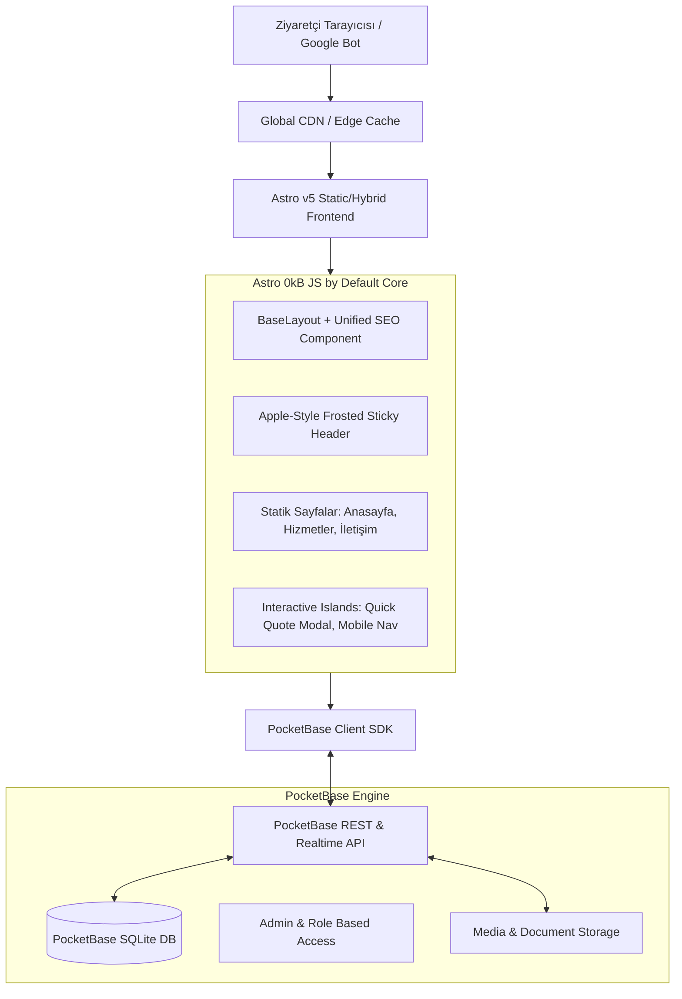

# System Patterns & Architecture: Çelebi Yönetim ve Temizlik

## 1. High-Level Architecture Overview

The system is built on an **ultra-lightweight, high-performance decoupled architecture**:



---

## 2. Core Architectural Principles

### A. Zero Client-Side JS by Default (Astro Islands)
- All landing pages, service descriptions, testimonials, and SEO content are rendered to pure static HTML/CSS.
- JavaScript is loaded **only** for strictly interactive components (e.g., dynamic mobile menu toggle, interactive quote calculator) using Astro client directives (`client:idle`, `client:visible`).
- Result: **0ms JS blocking time**, instantaneous First Input Delay / INP, 100/100 PageSpeed score.

### B. Apple-Grade Floating Frosted Header Pattern
- **Visuals**: Translucent glassmorphism (`backdrop-blur-md bg-white/75 border border-white/30 shadow-sm`).
- **Dynamic Scroll Reactivity**:
  - Top state: Relaxed padding, transparent borders, expansive breathing space.
  - Scrolled state: Compact padding, subtle floating shadow, elevated blur intensity.
- **Performance Execution**:
  - Fixed positioning with a preserved document spacer to guarantee **CLS = 0.00**.
  - Hardware-accelerated CSS properties (`transform: translate3d(0,0,0)`, `backdrop-filter`, `opacity`).
  - Scroll state toggled via a passive, throttled micro-listener (< 500 bytes) or CSS `scroll-driven` animations with graceful fallback.

### C. PocketBase Integration & Data Resilience
- PocketBase runs as a self-hosted single-binary service (or local instance during development).
- **Collections Schema**:
  1. `teklif_talepleri` (Quote requests: name, phone, email, service_type, building_units, details, status)
  2. `iletisim_mesajlari` (Direct contact inquiries)
  3. `hizmetler` (Services: title, slug, summary, icon, details, faq_items, is_featured)
  4. `yorumlar` (Client reviews: client_name, site_name, rating, comment, date)
  5. `site_ayarlari` (Global metadata, phone, email, address, working hours)
- **Data Resilience Pattern**:
  - The Astro frontend implements a robust fallback adapter. If the PocketBase server is ever unreachable during build time, static default data is gracefully injected so builds never break.

### D. Centralized Design Token System (Logo & Color Independence)
- Because the final logo and color palette are pending, all design colors are encapsulated in CSS custom properties and Tailwind semantic tokens:
  ```css
  :root {
    --color-surface-base: #FFFFFF;
    --color-surface-muted: #F8FAFC;
    --color-surface-subtle: #F1F5F9;
    --color-text-primary: #0F172A;
    --color-text-secondary: #475569;
    --color-text-muted: #94A3B8;
    --color-border: #E2E8F0;
    --color-border-subtle: #F1F5F9;
    
    /* Dynamic Brand Variables - Swappable in 1 line once logo arrives */
    --color-brand-primary: #0F172A; /* Slate black default */
    --color-brand-accent: #2563EB;  /* Pristine corporate blue accent */
    --color-brand-highlight: #38BDF8; /* Fresh hygienic cyan */
    --color-brand-success: #10B981;
  }
  ```

---

## 3. SEO & Structured Data Patterns

### Universal `<SEO />` Head Component
Every page receives an automated schema graph:
1. `Organization` & `LocalBusiness` schema with geographic coordinates, phone number, and service areas.
2. `Service` schema specifically detailing "Site Yönetimi" and "Profesyonel Temizlik".
3. `FAQPage` schema on service pages to capture Google search rich snippets.
4. Auto-generated canonical tags and OpenGraph image tags.

