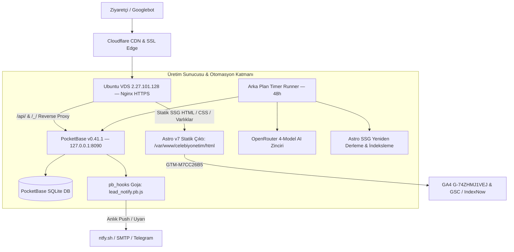

# System Patterns & Architecture: Çelebi Yönetim ve Temizlik

> Son Güncelleme: **22 Kasım 2026**

## 1. High-Level Architecture Overview

Sistem, statik ön yüz hızını PocketBase arka uç otomasyonları ve Google ölçümleme API'leriyle birleştiren **hafif, ölçeklenebilir bir ayrık (decoupled) mimari** üzerine kuruludur:

---

## 2. Core Architectural Principles

### A. Statik SSG + Islands Mimarisi ve Sıfır `301` URL Standardı
- Tüm iniş sayfaları, ilçe sayfaları (`/cukurova-site-yonetimi/`, `/seyhan-apartman-yonetimi/`, `/saricam-site-yonetimi/`), rehber araçları (`/site-yonetimi-fiyat-hesapla/`, `/apartman-karar-defteri-ornekleri/`) ve blog yazıları (`/yazilar/[slug]/`) build aşamasında saf statik HTML olarak üretilir.
- **Trailing-Slash Sıfır-301 Kuralı:** `astro.config.mjs` dosyasında `trailingSlash: 'always'` zorunludur. `SEO.astro`, `src/pages/yazilar/[slug].astro`, `src/pages/sitemap.xml.ts` ve `scripts/gsc-auto-index.py` tüm canonical ve sitemap `<loc>` adreslerini sonu `/` bitecek şekilde üretir; böylece Nginx ek `301` yönlendirmesi yapmaz.

### B. Apple-Grade Floating Frosted Header & İletişim Akışı
- Translucent glassmorphism header, sabit konum + korunan boşluk ile `CLS = 0.00` sağlar.
- Tüm sayfalarda ortak dönüşüm akışı: `QuickCallbackBar` ("5 Dakikada Arayalım"), `QuoteForm` (WhatsApp + PocketBase sıfır kayıplı kayıt + UTM/`gclid`/`fbclid` atıf takibi), masaüstü sağ alt dairesel su damlası iletişim butonları ve mobil sabit alt aksiyon çubuğu.

### C. PocketBase Koleksiyon Şeması & `pb_hooks` (Goja) Deseni
- **Aktif Canlı Koleksiyonlar:**
  1. `teklif_talepleri`: Talep bilgileri (`ad`, `telefon`, `hizmet_turu`, `ilce`, `daire_sayisi`, `mesaj`, `durum`, UTM / `gclid` / `fbclid` / `landing_page`).
  2. `makaleler`: Otonom ve manuel SEO rehber yazıları (`baslik`, `slug`, `ozet`, `icerik`, `kategori`, `ilce`, `gorsel`, `yayinda`).
  3. `site_ayarlari`: Adres, telefonlar, WhatsApp, harita ve çalışma bilgileri.
  4. `reklam_ayarlari`: `ga4Id`, `gadsId`, `gadsConvLead`, `gadsConvWhatsapp`, `gadsConvCall`, `metaPixelId` (`mg1xw4dnqlq3ix6`).
  5. `otomatik_yayin_ayarlari`: AI yayın döngüsü (`siklik: "48h"`, `aktif: true`, `hedefIlce: "auto"` — kayıt ID `31zfhnoi2ecarkf`).
  6. `bildirim_ayarlari`: Yalnızca süper kullanıcı erişimli (`null` API kuralları — kayıt ID `1afdyxr5l4cpk5q`) `ntfy.sh`, SMTP e-posta ve Telegram yapılandırması.
- **PocketBase v0.41.1 Goja Hook Kuralı:** Hook dosyalarında her callback izole kapsamda çalışır. Bu nedenle ortak yardımcı fonksiyonlar `scripts/pb_hooks/lead_notify_lib.js` içine yerleştirilir ve `lead_notify.pb.js` içinde `require(__hooks + "/lead_notify_lib.js")` ile yüklenir. Süper kullanıcı kontrolünde `$apis.requireSuperuserAuth()` fonksiyon olarak çağrılır.
- **Veri Dayanıklılığı:** Astro build sırasında PocketBase erişilemez olursa statik yedek veri devreye girer ve build kırılmaz.

### D. Marka Kimliği & Tasarım Token Sistemi
- İlk kurulumdaki yer tutucu logo süreci tamamlanmıştır; artık yatay çerçevesiz vektörel SVG marka kilidi (`public/assets/logo/celebi-logo.svg`) ve önbellek kırmalı (`cache-bust`) favicon seti aktiftir.
- Renk ve tipografi sistemi CSS custom properties (`--color-surface-*`, `--color-text-*`, `--color-brand-*`) üzerinden merkezi yönetilir.

### E. Ölçümleme (GTM / GA4) & Çift Sayım Koruması
- `GTM-M7CC26B5` doğrudan `src/layouts/BaseLayout.astro` `<head>` içine gömülüdür ve Google Analytics 4 (`G-74ZHMJ1VEJ` / `properties/565409453`) etiketini yönetir.
- PocketBase `reklam_ayarlari` kaydından gelen kimlikler yüklenirken `preloadedGoogleIds` listesi (`GTM-M7CC26B5`, `G-74ZHMJ1VEJ`) kontrol edilir; böylece aynı sayfa görüntülenmesi hem GTM hem de doğrudan `gtag.js` ile iki kez sayılmaz.
- Dönüşüm olayları (`generate_lead`, `whatsapp_click`, `phone_call_click`) GA4 tarafında `ONCE_PER_SESSION` ve sıfırlanmış varsayılan değerle izlenir; `service_type`, `method`, `landing_page` özel boyutlarıyla zenginleştirilir.

### F. Otonom AI İçerik Motoru & Kalite Kapısı (`timer-runner.py`)
- 4 modelli OpenRouter ücretsiz yedekleme sırası kullanılır (`nvidia/nemotron-3-ultra-550b-a55b:free` `reasoning: {"enabled": False}`, `baidu/ernie-5.5-flash-preview:free`, `openrouter/free`, `nvidia/nemotron-3.5-lightning:free`).
- Çıktı doğrulama kapısı: en az **3 adet `<h2>`**, `
` paragrafları ve **>= 260 kelime** şartı sağlanmazsa makale yayınlanmaz; hata durumunda `/tmp/celebi-ai-backoff.ts` üzerinden 30 dk soğuma uygulanır ve **asla şablon/boilerplate içerik basılmaz**.
- Türkçe uyumlu kategori normalizasyonu (`Temizlik`, `Hukuk & Mevzuat`, `Site Yönetimi`), ilçe etiketleme ve başlıktaki mükerrer ilçe öneki koruması uygulanır.

---

## 3. SEO & Structured Data Patterns

### Universal `<SEO />` Head & Agentic Discovery
Her sayfa otomatik olarak şu şema ve keşif sinyallerini alır:
1. `Organization` & `LocalBusiness` (Mahfesığmaz / Çukurova / Adana koordinatları, sabit ve mobil hatlar, ilçe `areaServed`).
2. `Service` & `CleaningService` / `ProfessionalService` şemaları.
3. Rehber ve karar defteri sayfalarında zengin sonuçlar için `FAQPage` ve `BreadcrumbList`.
4. `trailingSlash: 'always'` uyumlu `rel="canonical"`, OpenGraph, Twitter Card, `sitemap.xml`, `robots.txt`, `llms.txt` ve `ard.json`.
